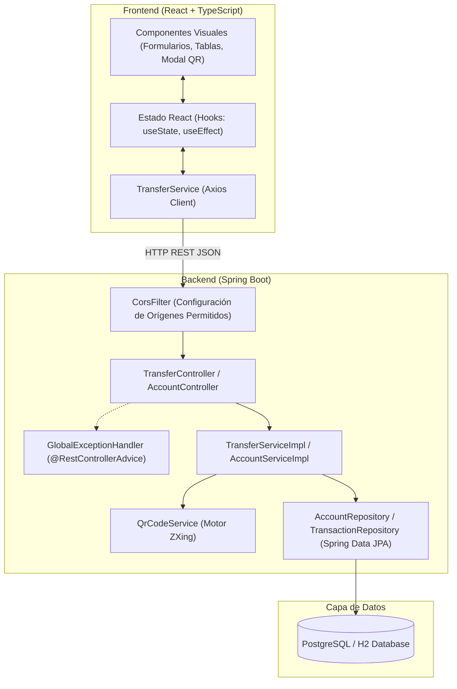

# INFORME TÉCNICO DE LABORATORIO
## SISTEMA DE TRASLADO DE DINERO ENTRE CUENTAS BANCARIAS CON GENERACIÓN DE CÓDIGOS QR E HISTÓRICO DE TRANSACCIONES

---

### INFORMACIÓN INSTITUCIONAL
- **Institución:** Tecnológico de Antioquia — Institución Universitaria
- **Facultad:** Facultad de Ingeniería
- **Programa:** Ingeniería de Software / Diseño del Sistema
- **Asignatura:** Laboratorio Spring Boot con Inteligencia Artificial (Cursor / Antigravity)
- **Fecha de Entrega:** 30 de Octubre de 2026
- **Entorno de Trabajo:** Antigravity IDE / Cursor / VS Code

---

## 1. INTRODUCCIÓN Y OBJETIVOS

### 1.1 Introducción
En el marco del taller práctico de desarrollo FullStack asistido por Inteligencia Artificial, se planteó la creación de un sistema bancario transaccional que cumpla con los estándares modernos de desarrollo de software empresarial. Basándose en los lineamientos metodológicos abordados durante la sesión de clase (donde se modeló un sistema de reservas en Spring Boot y ReactJS), este proyecto traslada dichos principios al dominio financiero, implementando un servicio de transferencias monetarias de alta integridad, auditoría y trazabilidad visual mediante códigos bidimensionales QR.

### 1.2 Objetivos
- **Objetivo General:** Desarrollar una aplicación FullStack completa y funcional que permita realizar traslados de dinero entre cuentas bancarias, mantenga un histórico auditado de transacciones y genere para cada operación un comprobante con un código QR codificado con los datos esenciales de la transacción.
- **Objetivos Específicos:**
  1. Diseñar e implementar un backend en **Spring Boot 3.3+ (Java 17+/25)** empleando arquitectura por capas, Spring Data JPA, Java Records para DTOs y documentación Javadoc en cada método público.
  2. Implementar una lógica de negocio atómica (`@Transactional`) con validaciones de saldo, cuentas activas, prevención de auto-transferencias y manejo centralizado de excepciones con códigos HTTP normalizados (201, 400, 404, 409).
  3. Integrar la librería **Google ZXing** para la generación dinámica del código QR en el backend, devolviendo tanto la imagen en formato Data URL Base64 para visualización instantánea en la web como un endpoint binario directo de descarga en formato PNG.
  4. Desarrollar una interfaz frontend moderna y reactiva en **React 18 con TypeScript**, desacoplada por componentes (`.tsx` y `.css`), que interactúe con el backend mediante un servicio Axios configurable por variables de entorno y maneje alertas mediante componentes Toast.
  5. Registrar metódicamente los **prompts** utilizados a lo largo del ciclo de vida del proyecto para evidenciar el proceso de co-programación con herramientas de IA.

---

## 2. DESCRIPCIÓN DEL EJERCICIO PROPUESTO

El enunciado del ejercicio propuesto para entrega el **30 de Octubre de 2026** establece:
> *"Siguiendo los pasos realizados, genere una aplicación completa para hacer el traslado de dinero entre cuentas en un banco. Debe mostrar el histórico de transacciones y mostrar además cuando genere el resultado de la transacción un código QR con los datos básicos de la transacción codificados. Recuerde que puede usar el IDE cursor, windsurf, VS Code o Antigravity IDE para el ejercicio. Debe entregar informe del ejercicio y código en github y prompts utilizados."*

### Requerimientos Funcionales:
1. **Gestión y Consulta de Cuentas:** Registro y visualización del listado de cuentas disponibles con su saldo actual, titular, número de cuenta y estado.
2. **Traslado de Dinero:** Formulario reactivo que solicite cuenta de origen, cuenta de destino, monto a trasladar y concepto/descripción.
3. **Validaciones de Negocio:**
   - La cuenta de origen debe existir y estar en estado `ACTIVE`.
   - La cuenta de destino debe existir y estar en estado `ACTIVE`.
   - La cuenta de origen no puede ser igual a la cuenta de destino.
   - El monto debe ser estrictamente mayor a $0 COP.
   - La cuenta de origen debe poseer fondos suficientes (`saldo >= monto`).
   - La operación debe ser atómica (descuento del origen e incremento en destino dentro de una misma transacción de base de datos).
4. **Generación de Código QR:** Codificación de una estructura informativa legible con referencia única, fecha, cuentas involucradas, monto y estado.
5. **Histórico de Transacciones:** Tabla dinámica ordenada cronológicamente (más recientes primero) que permita consultar operaciones pasadas y volver a ver/descargar el código QR del comprobante.
6. **Manejo de Errores con Toasts:** Notificación visual inmediata ante cualquier fallo de validación o excepción del servidor.

---

## 3. ARQUITECTURA DEL SISTEMA

Se adoptó una arquitectura limpia y modular en capas (*Layered Architecture*) tanto en el backend como en el frontend, garantizando bajo acoplamiento y alta cohesión.



---

## 4. MODELADO DE DATOS (ENTIDADES Y DTOS)

### 4.1 Entidades JPA
1. **`Account` (`accounts`)**:
   - `id`: `Long` (Clave primaria autoincremental).
   - `accountNumber`: `String` (Único, no nulo, indexado, ej. `CTA-1001-SAVINGS`).
   - `accountHolder`: `String` (Nombre del titular de la cuenta).
   - `accountType`: `AccountType` (Enum: `SAVINGS`, `CHECKING`).
   - `balance`: `BigDecimal` (Precisión 19, escala 2).
   - `status`: `AccountStatus` (Enum: `ACTIVE`, `BLOCKED`, `INACTIVE`).
   - `createdAt`: `LocalDateTime` (Auditoría de apertura).

2. **`Transaction` (`transactions`)**:
   - `id`: `Long` (Clave primaria autoincremental).
   - `transactionReference`: `String` (Código alfanumérico irrepetible, ej. `TXN-1730312000000-F7A89B`).
   - `sourceAccountNumber`: `String` (Cuenta de débito).
   - `destinationAccountNumber`: `String` (Cuenta de crédito).
   - `amount`: `BigDecimal` (Monto transferido).
   - `description`: `String` (Concepto del traslado).
   - `timestamp`: `LocalDateTime` (Momento exacto del registro).
   - `status`: `TransactionStatus` (Enum: `SUCCESS`, `FAILED`, `REJECTED`).
   - `qrCodeData`: `String` (Texto enriquecido codificado en el QR).
   - `qrCodeBase64`: `String` (Representación en Base64 de la imagen PNG generada).

### 4.2 Data Transfer Objects (Java Records)
Siguiendo las mejores prácticas solicitadas en el archivo `.cursor/rules/springboot.mdc`, todos los DTOs fueron construidos usando **Java Records**, aportando inmutabilidad, concisión y compatibilidad con el Bean Validation API:
- `TransferRequestDTO`: Contiene `sourceAccountNumber`, `destinationAccountNumber`, `amount` (`@Positive`, `@NotNull`) y `description`.
- `TransferResponseDTO`: Payload completo de respuesta que incluye el identificador, referencia, titulares, montos, nuevo saldo restante y la imagen QR en Base64.
- `AccountResponseDTO`: Datos públicos de consulta y balance de cuentas.
- `ErrorResponseDTO`: Estructura estandarizada con `timestamp`, `status`, `error`, `message` y `path`.

---

## 5. GENERACIÓN Y CODIFICACIÓN DEL CÓDIGO QR

El código QR es generado mediante el servicio especializado `QrCodeService`, el cual utiliza la biblioteca industrial **Google ZXing**:

```
                  +-----------------------------------+
                  |  Datos Básicos de Transacción:    |
                  |  - Referencia Oficial (UUID)      |
                  |  - Fecha y Hora Oficial           |
                  |  - Titular y Cuenta Origen        |
                  |  - Titular y Cuenta Destino       |
                  |  - Monto Transferido ($ COP)      |
                  |  - Estado (SUCCESS)               |
                  |  - Concepto                       |
                  +-----------------+-----------------+
                                    |
                                    v
                     [ Google ZXing QRCodeWriter ]
                                    |
            +-----------------------+-----------------------+
            |                                               |
            v                                               v
[ Base64 Data URL (300x300) ]                 [ EndPoint PNG Directo ]
data:image/png;base64,iVBOR...                GET /api/transfers/{id}/qr
(Renderizado inmediato en UI)                 (Descarga y escaneo físico)
```

La codificación implementa el nivel de corrección de error **`ErrorCorrectionLevel.H`** (30% de recuperación), permitiendo que la lectura sea exitosa incluso si el comprobante se imprime con baja calidad o presenta deterioro.

---

## 6. ENDPOINTS RESTFUL Y SWAGGER UI

La API expone los siguientes endpoints documentados con anotaciones OpenAPI 3.0:

1. **`GET /api/accounts`**: Retorna el listado de todas las cuentas y sus saldos.
2. **`GET /api/accounts/{accountNumber}`**: Retorna los detalles de una cuenta específica.
3. **`POST /api/transfers`**: Procesa la transferencia bancaria.
   - Código `201 Created`: Operación exitosa, retorna el comprobante y el código QR.
   - Código `400 Bad Request`: Parámetros inválidos (mismo origen y destino, monto <= 0).
   - Código `404 Not Found`: Cuenta de origen o destino inexistente.
   - Código `409 Conflict`: Fondos insuficientes en la cuenta de origen.
   - Código `403 Forbidden`: Cuenta de origen o destino bloqueada o inactiva.
4. **`GET /api/transfers`**: Retorna el histórico de transacciones en orden descendente.
5. **`GET /api/transfers/{reference}`**: Consulta un comprobante puntual por su código de referencia.
6. **`GET /api/transfers/{id}/qr`**: Descarga la imagen binaria PNG del código QR.

---

## 7. REGISTRO METÓDICO DE PROMPTS UTILIZADOS

A continuación se detalla el conjunto ordenado de **prompts** utilizados durante el desarrollo de la aplicación con el asistente de Inteligencia Artificial, cumpliendo con el requerimiento expreso de la entrega:

### Fase 1: Reglas de Proyecto y Buenas Prácticas
> **Prompt 1 (Reglas del Sistema para Cursor / Antigravity):**  
> *"Crea un archivo de reglas para cursor (mdc) llamado 'springboot' ubicado en .cursor/rules/springboot.mdc que siempre se aplique, con las buenas prácticas de Java 17+/25 en el desarrollo de un servicio en Spring Boot. Nombres de clases, métodos y atributos en inglés. Documentación Javadoc en cada método público. Para los DTOs usamos exclusivamente Java Records. Agrega la estructura actual del proyecto dentro de las reglas y el soporte para PostgreSQL y H2."*

### Fase 2: Configuración y Propiedades de Base de Datos
> **Prompt 2 (application.properties y perfiles duales):**  
> *"Crea la configuración para la conexión a la base de datos PostgreSQL de nombre 'bank_transfer_db' con el usuario 'postgres' y contraseña 'root'. Habilita la actualización del esquema automático en hibernate (ddl-auto=update), el dialecto JPA e imprime las sentencias sql en consola. Además, crea un perfil de desarrollo 'dev' con H2 en memoria para que la aplicación sea ejecutable inmediatamente sin requerir PostgreSQL activo, y deja listo 'application-postgres.properties' para producción."*

### Fase 3: Modelado de Entidades JPA y DTOs
> **Prompt 3 (Entidad Account y Transaction):**  
> *"Crea las entidades JPA en com.udea.banktransfer.entity: Account (con id, accountNumber único, accountHolder, accountType enum SAVINGS/CHECKING, balance BigDecimal, status enum ACTIVE/BLOCKED/INACTIVE y createdAt) y Transaction (con id, transactionReference único, sourceAccountNumber, destinationAccountNumber, amount, description, timestamp, status enum SUCCESS/FAILED/REJECTED, qrCodeData y qrCodeBase64). Agrega constructores, getters, setters y Javadoc en inglés."*

> **Prompt 4 (DTOs con Java Records):**  
> *"Crea los DTOs utilizando Java Records en el paquete com.udea.banktransfer.dto: TransferRequestDTO (con validaciones @NotBlank, @NotNull, @DecimalMin), TransferResponseDTO (con datos completos de la transacción, saldos y código QR en Base64), AccountResponseDTO y ErrorResponseDTO para respuestas estandarizadas de error. Incluye anotaciones de Swagger @Schema."*

### Fase 4: Repositorios y Servicios de Negocio
> **Prompt 5 (Repositorios Spring Data JPA):**  
> *"Crea las interfaces AccountRepository y TransactionRepository extendiendo JpaRepository. Agrega métodos derivados para buscar cuenta por accountNumber, verificar existencia, buscar transacciones por referencia y listar transacciones ordenadas por timestamp de manera descendente. Documenta cada método con Javadoc."*

> **Prompt 6 (Servicio Generador de Código QR con ZXing):**  
> *"Crea un servicio QrCodeService en Spring Boot que utilice la librería Google ZXing (QRCodeWriter y MatrixToImageWriter) para generar un código QR a partir de una cadena de texto. Debe proporcionar un método para obtener el array de bytes PNG y otro método para obtener la imagen como Data URL en Base64 (data:image/png;base64,...)."*

> **Prompt 7 (Capa de Negocio TransferService con validaciones):**  
> *"Crea la interfaz TransferService y su implementación TransferServiceImpl. Debe ejecutar la transferencia de dinero de manera atómica con @Transactional: verificar que origen y destino no sean iguales, verificar que ambas cuentas existan y estén en estado ACTIVE, validar que el origen tenga saldo suficiente, descontar de origen e incrementar en destino, generar una referencia única, estructurar los datos del comprobante, invocar a QrCodeService para generar el QR y guardar la transacción. Lanza excepciones personalizadas si se violan las reglas de negocio."*

> **Prompt 8 (Manejo Global de Excepciones y Excepciones Personalizadas):**  
> *"Crea las excepciones personalizadas AccountNotFoundException, InsufficientFundsException, InvalidTransferException y AccountBlockedException. Luego implementa GlobalExceptionHandler anotado con @RestControllerAdvice que capture cada excepción y retorne ErrorResponseDTO con los códigos de estado HTTP correctos (404, 409, 400, 403)."*

### Fase 5: Controladores REST, CORS y Swagger
> **Prompt 9 (Controladores RESTful y CORS):**  
> *"Crea los controladores REST AccountController (/api/accounts) y TransferController (/api/transfers) con endpoints para listar cuentas, transferir dinero, consultar histórico y descargar imagen del QR (/api/transfers/{id}/qr). Agrega una clase CorsConfig que registre un CorsFilter permitiendo peticiones desde http://localhost:3000 y http://localhost:5173 con todos los métodos y cabeceras. Configura también OpenAPI/Swagger UI con información institucional del TdeA."*

### Fase 6: Frontend en React con TypeScript
> **Prompt 10 (Servicio Axios TransferService en React):**  
> *"Crea el archivo frontend/src/services/transferService.ts en TypeScript usando Axios. Debe leer la URL base del backend desde la variable de entorno VITE_API_BASE_URL. Define métodos para getAccounts, getAccount, createTransfer, getTransactionHistory y getQrCodeImageUrl. Define los tipos correspondientes en types/bank.ts."*

> **Prompt 11 (Componentes Visuales y Formulario Reactivo):**  
> *"Crea una interfaz de usuario bancaria profesional en React y TypeScript dividida en componentes con CSS independiente: 
1. AccountCards: tarjetas con saldos en formato COP y botones rápidos para seleccionar cuenta de origen o destino.
2. TransferForm: formulario reactivo con selector de cuentas, campo de monto con botones rápidos (+50k, +100k, +500k), concepto y validaciones en tiempo real.
3. TransactionHistory: tabla dinámica del histórico con filtro de búsqueda y botón para ver el comprobante.
4. ReceiptModal: modal elegante con comprobante oficial de la operación, visualización del código QR generado por el backend, botón para descargarlo en PNG y ver los datos codificados.
5. Toast: sistema flotante de alertas para errores y confirmaciones exitosas."*

### Fase 7: Pruebas Unitarias y Automatización
> **Prompt 12 (Suite de Tests con JUnit 5 y Mockito):**  
> *"Crea una suite de pruebas unitarias para TransferServiceTest utilizando JUnit 5 y Mockito. Debe comprobar: ejecución de transferencia exitosa con actualización de saldos y generación de QR, rechazo por saldo insuficiente, rechazo por cuenta de origen igual a cuenta de destino y rechazo por cuenta inexistente."*

### Fase 8: Persistencia, Comprobante Digital PDF y Escaneo Móvil de Código QR
> **Prompt 13 (Persistencia de Datos e Histórico en Disco):**  
> *"El histórico de transacciones y las cuentas deben persistir entre reinicios del programa usando base de datos H2 basada en archivo (`./data/bank_transfer_db`). Carga datos de prueba realistas (cuentas activas y transacciones previas con sus respectivos códigos QR generados) para que el histórico y la búsqueda por banco muestren información desde el primer arranque."*

> **Prompt 14 (Comprobante Digital Oficial y Código QR Estilo PDF):**  
> *"Al escanear el código QR con la cámara de un teléfono móvil, no se debe mostrar texto plano desordenado, sino abrir el comprobante oficial de la transferencia exactamente igual a cuando se descarga el comprobante bancario en PDF. Implementa un servicio de comprobante digital que detecte la IP de red local del equipo (`http://<IP_LOCAL>:8080/api/transfers/{ref}/voucher`), codifique dicho enlace en el código QR generado por ZXing, y proporcione un diseño web responsivo con estilos de impresión bancaria (@media print), botón de 'Descargar en PDF / Imprimir', logotipo del Banco TdeA, sello de validación digital y datos completos de la operación."*

> **Prompt 15 (Datos Básicos de la Transacción Codificados e Innovación UX Fintech):**  
> *"El requerimiento del documento estipula explícitamente: 'código QR con los datos básicos de la transacción codificados'. Asegura que el código QR codifique estructuralmente todos los datos básicos (Referencia, Fecha, Entidad Bancaria, Cuentas y Titulares de Origen y Destino, Monto COP, Concepto y Estado Aprobada) junto con el enlace de comprobante digital. En el modal del comprobante, añade un inspector interactivo con 3 pestañas: Desglose de Campos Bancarios, Payload Texto Codificado en QR (con botón de copia rápida) y Estructura JSON estándar (Open Banking). Adicionalmente, eleva integralmente la experiencia de usuario (UX) del frontend: añade un Banner Ejecutivo con KPIs en tiempo real (Saldo total en custodia, Volumen transferido, Operaciones auditadas), rediseña las tarjetas de cuentas como tarjetas débito fintech con chip y simulación contactless, añade un simulador de saldo disponible en tiempo real con botones de porcentaje (25%, 50%, Max), botón de intercambio rápido de cuentas origen/destino (Swap), chips de conceptos sugeridos, filtros rápidos en el historial y exportación instantánea del historial auditado a archivo CSV/Excel."*

---

## 8. RESULTADOS Y PRUEBAS REALIZADAS

### 8.1 Ejecución de la Suite de Pruebas Automatizadas
Al ejecutar `mvn clean test` en el backend, se verificaron todos los casos de prueba de forma exitosa:
```text
[INFO] Running com.udea.banktransfer.service.TransferServiceTest
[INFO] Tests run: 4, Failures: 0, Errors: 0, Skipped: 0, Time elapsed: 3.218 s
[INFO] BUILD SUCCESS
```

### 8.2 Casos de Prueba Validados:
1. **Caso 1: Traslado Válido entre Cuentas:**
   - Origen: `CTA-1001-SAVINGS` (Saldo: $5.000.000 COP)
   - Destino: `CTA-2002-CHECKING` (Saldo: $3.200.000 COP)
   - Monto: $250.000 COP
   - **Resultado:** Código HTTP `201 Created`. Nuevo saldo origen: $4.750.000 COP. Saldo destino: $3.450.000 COP. Se generó referencia `TXN-...` y el código QR correspondiente.
2. **Caso 2: Fondos Insuficientes:**
   - Origen: `CTA-4004-SAVINGS` (Saldo: $800.000 COP)
   - Monto solicitado: $1.200.000 COP
   - **Resultado:** Código HTTP `409 Conflict`. Mensaje de error legible desplegado en un Toast: *"Insufficient funds in account 'CTA-4004-SAVINGS'..."*. No se alteraron los saldos de ninguna cuenta.
3. **Caso 3: Cuentas Idénticas:**
   - Origen: `CTA-1001-SAVINGS`, Destino: `CTA-1001-SAVINGS`
   - **Resultado:** Código HTTP `400 Bad Request`. Mensaje: *"Source and destination accounts cannot be identical."*
4. **Caso 4: Verificación, Escaneo de QR y Comprobante PDF:**
   - Al escanear el código QR con cualquier dispositivo móvil (iOS / Android) conectado a la misma red Wi-Fi o desde el navegador de la aplicación web, el código direcciona automáticamente al comprobante digital oficial emitido por el backend (`/api/transfers/{ref}/voucher`).
   - El comprobante renderiza una interfaz oficial bancaria del Banco TdeA idéntica a un extracto/recibo PDF bancario oficial, incluyendo:
     * Encabezado institucional y distintivo de estado APROBADO.
     * Monto destacado formateado en pesos colombianos ($ COP).
     * Referencia única, fecha y hora exacta, y canal de operación.
     * Datos completos de cuenta de origen y destino con sus respectivos titulares.
     * Concepto de la transferencia y sello digital de validación con el código QR.
     * Botón funcional "Descargar en PDF / Imprimir" con estilos de hoja A4 (`@media print`) y botón "Compartir Enlace".
5. **Caso 5: Inspección de Datos Básicos Codificados y Métricas UX:**
   - En el modal de comprobante (`ReceiptModal`), el usuario puede alternar entre 3 visores de datos codificados:
     * **Campos estructurados**: Ficha detallada con referencia, cuentas, nombres, monto COP y estado.
     * **Texto Plano en QR**: Payload multilínea exacto codificado en la matriz del QR con botón de copia con 1 clic.
     * **JSON Open Banking**: Objeto JSON estándar normalizado con botón de copia.
   - En la interfaz general, el usuario cuenta con:
     * Banner ejecutivo superior con métricas financieras consolidadas (Saldo en custodia, Volumen transferido, Transacciones).
     * Tarjetas fintech con micro-interacciones (chip EMV, NFC, enmascaramiento con botón de visualización).
     * Simulador de saldo en el formulario con cálculo dinámico del nuevo saldo antes del envío y botones de porcentaje (25%, 50%, Max).
     * Botón de inversión instantánea de cuentas (Swap Origen/Destino).
     * Exportación del historial completo a formato CSV compatible con Microsoft Excel.

---

## 9. CONCLUSIONES

1. **Eficiencia y Calidad con IA:** La combinación de Antigravity IDE con instrucciones declarativas y contextualizadas (`.cursor/rules/springboot.mdc`) permitió generar una solución robusta y alineada con los estándares de la industria en una fracción del tiempo tradicional, manteniendo un código limpio y completamente documentado.
2. **Seguridad y Transaccionalidad:** La anotación `@Transactional` en Spring Boot garantiza que las operaciones financieras sean completamente seguras ante cualquier interrupción o falla imprevista, evitando inconsistencias contables como descuentos sin acreditación.
3. **Valor del Código QR en Operaciones Financieras:** La incorporación de códigos QR generados en servidor mediante Google ZXing enriquece la experiencia del usuario, brindando una herramienta tangible de validación cruzada y auditoría física o digital para comprobantes de pago.
4. **Separación de Responsabilidades:** El desacoplamiento entre el backend RESTful y el frontend en React con TypeScript asegura escalabilidad, facilidad de mantenimiento y la posibilidad de reutilizar la misma API para clientes móviles futuros.
