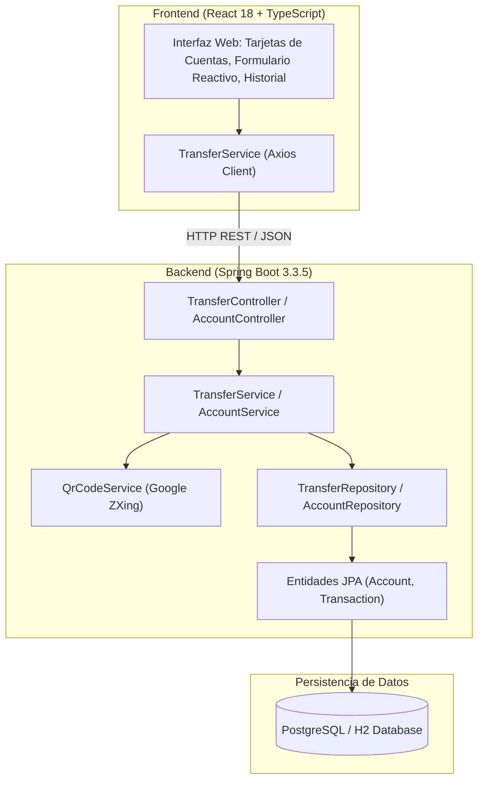

# Sistema Bancario de Transferencias con Código QR 🏦📲
### Tecnológico de Antioquia — Facultad de Ingeniería
**Materia:** Diseño del Sistema / FullStack  
**Fecha de Entrega:** 30 de Octubre de 2026  
**Entorno de Desarrollo:** Antigravity IDE / Cursor / VS Code  

---

## 📌 1. Descripción del Proyecto

Aplicación FullStack completa desarrollada para la gestión y ejecución de **traslados de dinero entre cuentas bancarias**, consulta de **histórico de transacciones** auditadas en tiempo real y generación dinámica de un **código QR de comprobante** que contiene los metadatos esenciales de cada operación (referencia, fecha, cuentas origen y destino, monto y estado).

El proyecto fue construido siguiendo estrictamente las directrices del laboratorio de clase con **Spring Boot** en el backend y **React con TypeScript** en el frontend, aplicando arquitectura limpia, convención de nombres en inglés, Java Records para DTOs, documentación Javadoc y persistencia relacional con JPA / PostgreSQL / H2.

---

## 🛠️ 2. Stack Tecnológico

### Backend
- **Lenguaje:** Java 17+ (LTS) / Java 25 compatible
- **Framework:** Spring Boot 3.3.5 / 4.x
  - `spring-boot-starter-web`: API RESTful con controladores estructurados
  - `spring-boot-starter-data-jpa`: Persistencia ORM con Hibernate
  - `spring-boot-starter-validation`: Validaciones declarativas de negocio
- **Bases de Datos:**
  - **PostgreSQL:** Configurado para producción o entorno local (`application-postgres.properties`)
  - **H2 In-Memory:** Perfil de desarrollo activo (`application-dev.properties`) para ejecución inmediata sin dependencias externas
- **Documentación OpenAPI:** SpringDoc OpenAPI v2.6.0 (Swagger UI interactivo)
- **Generación de QR:** Google ZXing (Zebra Crossing) v3.5.3 (codificación matricial BitMatrix a PNG y Base64 Data URL)
- **Gestor de Compilación:** Apache Maven

### Frontend
- **Framework & Biblioteca:** React 18 + TypeScript + Vite
- **Cliente HTTP:** Axios con cliente configurado por variable de entorno
- **Iconografía & Estilos:** Lucide React + CSS moderno con variables personalizadas y responsive design
- **Efectos:** Canvas Confetti para confirmación visual de transacciones exitosas
- **Estructura:** Componentes desacoplados con hojas de estilo dedicadas (`.tsx` + `.css`)

---

## 🏛️ 3. Arquitectura del Sistema



---

## 🚀 4. Guía de Instalación y Ejecución

### Prerrequisitos
- **Java JDK 17+** instalado y en el PATH (`java -version`).
- **Maven** instalado (`mvn -version`).
- **Node.js 20+** y **npm** instalados (`node -v` y `npm -v`).

### Paso 1: Ejecución del Backend (Spring Boot)
1. Abre una terminal en la carpeta `backend`:
   ```bash
   cd backend
   ```
2. Compila y ejecuta los tests unitarios:
   ```bash
   mvn clean test
   ```
3. Inicia el servidor Spring Boot en el puerto `8080`:
   ```bash
   mvn spring-boot:run
   ```
4. El backend estará listo en:
   - **API Base:** `http://localhost:8080/api`
   - **Swagger UI:** `http://localhost:8080/swagger-ui.html`
   - **Consola H2 (perfil dev):** `http://localhost:8080/h2-console` (JDBC URL: `jdbc:h2:mem:bank_transfer_db`, User: `sa`, Password: en blanco)

> [!NOTE]
> **Conexión a PostgreSQL:**
> Para conectar la aplicación a un servidor PostgreSQL local tal como se explica en la guía de clase:
> 1. Crea la base de datos en pgAdmin: `bank_transfer_db`.
> 2. En `backend/src/main/resources/application.properties`, cambia `spring.profiles.active=postgres`.
> 3. Ajusta las credenciales en `application-postgres.properties` si tu contraseña difiere de `root`.

---

### Paso 2: Ejecución del Frontend (React + Vite)
1. Abre otra terminal en la carpeta `frontend`:
   ```bash
   cd frontend
   ```
2. Instala las dependencias (si no se han instalado previamente):
   ```bash
   npm install
   ```
3. Lanza el servidor de desarrollo en el puerto `3000`:
   ```bash
   npm run dev
   ```
4. Abre tu navegador web en: `http://localhost:3000`.

---

## 🌐 5. Endpoints de la API REST

| Método | Endpoint | Descripción | Código Éxito | Códigos Error |
| :--- | :--- | :--- | :--- | :--- |
| `GET` | `/api/accounts` | Lista todas las cuentas bancarias con sus saldos | `200 OK` | `500` |
| `GET` | `/api/accounts/{accountNumber}` | Obtiene los detalles de una cuenta específica | `200 OK` | `404` |
| `POST` | `/api/transfers` | Ejecuta un traslado de dinero y genera el QR | `201 Created` | `400`, `404`, `409` |
| `GET` | `/api/transfers` | Consulta el histórico completo de transacciones | `200 OK` | `500` |
| `GET` | `/api/transfers/{reference}` | Obtiene el comprobante de una transacción | `200 OK` | `404` |
| `GET` | `/api/transfers/{id}/qr` | Descarga la imagen PNG directa del código QR | `200 OK` | `404` |

### Ejemplo de Petición (`POST /api/transfers`):
```json
{
  "sourceAccountNumber": "CTA-1001-SAVINGS",
  "destinationAccountNumber": "CTA-2002-CHECKING",
  "amount": 250000.00,
  "description": "Pago mensual cuota de arrendamiento"
}
```

### Ejemplo de Respuesta con Código QR:
```json
{
  "id": 1,
  "transactionReference": "TXN-1730312000000-F7A89B",
  "sourceAccountNumber": "CTA-1001-SAVINGS",
  "sourceAccountHolder": "Carlos Gómez Restrepo",
  "destinationAccountNumber": "CTA-2002-CHECKING",
  "destinationAccountHolder": "María Camila Rodríguez",
  "amount": 250000.00,
  "description": "Pago mensual cuota de arrendamiento",
  "timestamp": "2026-10-30T10:15:30.123456",
  "status": "SUCCESS",
  "sourceRemainingBalance": 4750000.00,
  "qrCodeData": "BANCO TdeA - COMPROBANTE DE TRANSFERENCIA\nRef: TXN-1730312000000-F7A89B\nFecha: 2026-10-30 10:15:30\nOrigen: CTA-1001-SAVINGS (Carlos Gómez Restrepo)\nDestino: CTA-2002-CHECKING (María Camila Rodríguez)\nMonto: $250.000,00 COP\nEstado: SUCCESS\nConcepto: Pago mensual cuota de arrendamiento",
  "qrCodeBase64": "data:image/png;base64,iVBORw0KGgoAAAANSUhEUgAAASw..."
}
```

---

## 📱 6. Características del Código QR
El código QR codifica una cadena formateada con todos los datos clave de auditoría requeridos por entidades bancarias:
1. **Entidad Emisora:** Banco TdeA
2. **Referencia Única:** UUID / Alfanumérico irrepetible
3. **Fecha y Hora Oficial**
4. **Cuentas y Titulares:** Origen y Destino
5. **Monto Transferido:** Formateado en COP
6. **Estado de Transacción:** SUCCESS
7. **Concepto:** Descripción del traslado

La imagen es generada en servidor con **nivel de corrección de error H (High - 30% de redundancia)**, lo que garantiza su lectura impecable desde cualquier teléfono móvil o escáner óptico.

---

## 🧪 7. Pruebas Unitarias
El backend incluye una suite de pruebas automatizadas con **JUnit 5** y **Mockito** en `TransferServiceTest`:
- Traslado exitoso con actualización atómica de saldos y generación de QR.
- Lanzamiento de `InsufficientFundsException` ante saldo insuficiente.
- Lanzamiento de `InvalidTransferException` cuando la cuenta origen y destino son idénticas.
- Lanzamiento de `AccountNotFoundException` cuando la cuenta de destino no existe.

Ejecutar pruebas:
```bash
cd backend
mvn test
```

---

## 📝 8. Creado por
- **Institución:** Tecnológico de Antioquia (TdeA)
- **Curso:** Laboratorio Spring Boot con IA 2026
